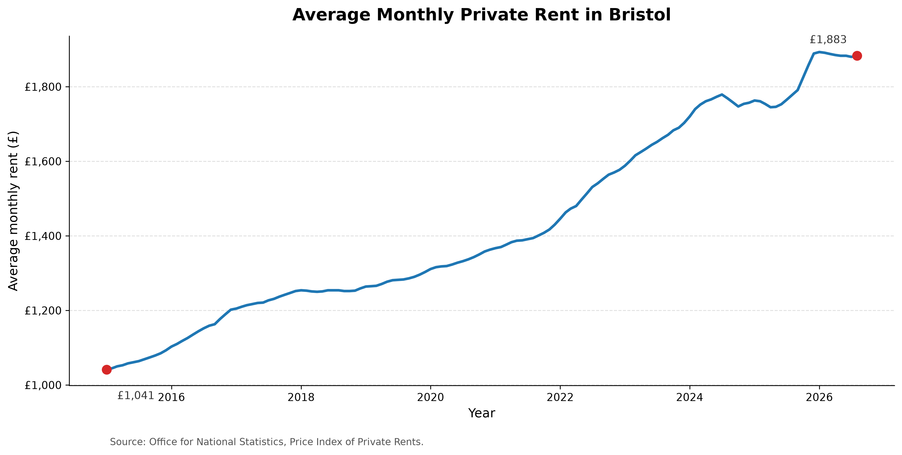
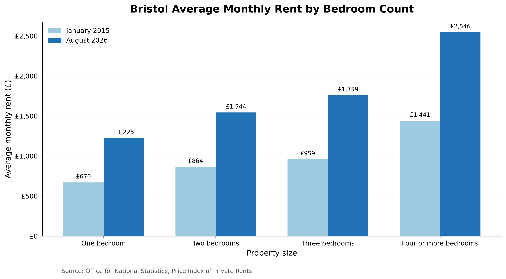
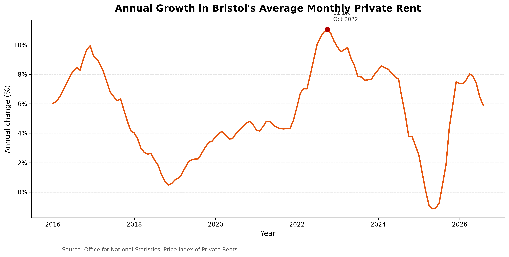
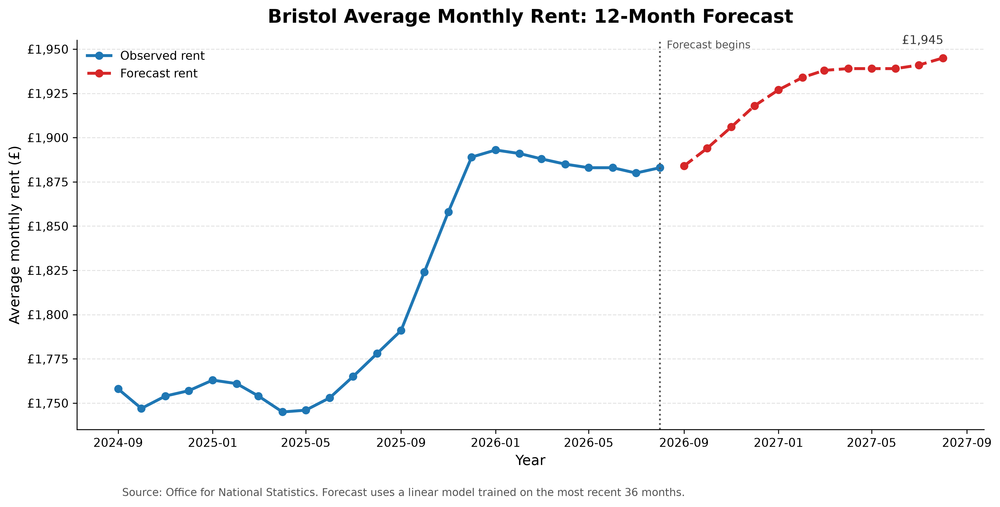

# Bristol Rental Intelligence

A data-science project analysing official private-rent data for Bristol, UK. The project explores rent trends by time, bedroom count, and property type, then evaluates forecasting models to estimate average monthly rent over the next 12 months.

## Project question

How have average private rents in Bristol changed since 2015, and what does a validated forecasting model estimate for the following 12 months?

## Key findings

- Bristol's average monthly private rent increased from **£1,041 in January 2015** to **£1,883 in August 2026**.
- This is an increase of **£842 per month**, or **80.9%** over the full period.
- The highest annual rental growth rate was **11.1% in October 2022**.
- Three-bedroom properties had the largest percentage rent increase from 2015 to 2026: **83.4%**.
- The selected forecasting model estimates average monthly rent could rise from **£1,884 in September 2026** to **£1,945 in August 2027**.

## Visualisations

### Overall Bristol rental trend



### Rent by bedroom count



### Annual rental growth



### 12-month rent forecast



## Data source

The analysis uses the Office for National Statistics (ONS) [Price Index of Private Rents: monthly price statistics](https://www.ons.gov.uk/economy/inflationandpriceindices/datasets/priceindexofprivaterentsukmonthlypricestatistics).

The ONS figures are official area-level estimates. They are not individual rental listings and should not be used to price a specific property.

## Method

1. Downloaded the ONS monthly private-rent Excel dataset.
2. Identified and filtered records for **Bristol, City of** using ONS area code `E06000023`.
3. Converted rent fields into numeric values and handled unavailable annual comparisons as missing values.
4. Created visualisations for overall rent trends, bedroom categories, and annual rent growth.
5. Reserved the most recent 12 months as unseen test data.
6. Compared three forecasting approaches:
   - Naive baseline
   - Full-history trend and seasonality regression
   - Recent 36-month trend and seasonality regression
7. Selected the recent 36-month model because it had the lowest test-period error.

## Model performance

| Model | MAE (£) | RMSE (£) | MAPE (%) |
|---|---:|---:|---:|
| Naive baseline | 92.67 | 97.48 | 4.93 |
| Full-history trend and seasonality | 68.66 | 72.02 | 3.66 |
| Recent 36-month trend and seasonality | **24.52** | **31.07** | **1.31** |

MAE is the average prediction error in pounds. Lower values are better.

## Forecast limitation

The final forecast is an illustrative statistical estimate, not a guarantee. It is based on historical rent patterns and cannot account for unexpected changes in the economy, policy, housing supply, or local demand.

## Project structure

```text
bristol-rental-intelligence/
├── data/
│   ├── raw/                         # Original ONS source data
│   └── processed/                   # Clean dataset and forecast output
├── notebooks/
│   ├── 01_data_acquisition.ipynb
│   └── 02_rent_forecast_model.ipynb
├── reports/
│   └── figures/                     # Saved charts
├── src/                              # Reusable Python scripts
├── app/                              # Future Streamlit dashboard
├── tests/                            # Future automated tests
├── requirements.txt
├── .gitignore
└── README.md